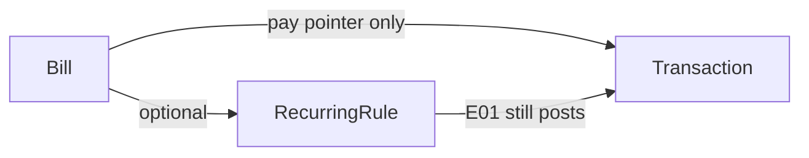

# Hóa đơn — BE-P2-E03 / MOB-P2-E03

Contract: [OpenAPI](../../packages/api-contracts/openapi.yaml) `/api/v1/bills`. Module: [08-bills](../product/modules/08-bills.md).

## Mô hình

- `Bill`: nghĩa vụ thanh toán, không phải bút toán. Số tiền BigInt **dương** (minor units). `amountKind` = `fixed` | `estimated`.
- Một lần (`recurringRuleId` null) hoặc gắn một `RecurringRule` cùng user. Xóa rule → `SET NULL` (hóa đơn còn, thành một lần).
- Đã trả khi `paidTransactionId` trỏ tới một `Transaction` chưa xóa của user. Unique: một giao dịch trả nhiều nhất một hóa đơn. `onDelete: SetNull`.
- Quá hạn **tính khi đọc**: chưa trả và `dueOn` trước hôm nay theo `User.timezone`. Không worker, không tự tạo giao dịch.

## API

Bearer session, `Cache-Control: no-store`, tiền là string integer dương.

- `POST /api/v1/bills` — `Idempotency-Key` = `clientId`.
- `GET /api/v1/bills?status=open|overdue|paid` — response có `paid` và `overdue`.
- `GET/PATCH/DELETE /api/v1/bills/{id}`
- `POST /api/v1/bills/{id}/pay` — chỉ gắn `transactionId` có sẵn; không insert giao dịch.
- `POST /api/v1/bills/{id}/unpay` — xóa con trỏ.

Có trong `GET /account/export` (`bills`) và xóa theo user. Không log tên hóa đơn / số tiền.

## Mobile

Feature `lib/features/bills/`. Màn `/me/bills` từ Thiết lập tài chính (sau Định kỳ). Đánh dấu đã trả chọn giao dịch có sẵn; không mở form ghi mới.

Nhắc đẩy thuộc `BE-P2-E05`. Lịch tháng thuộc `MOB-P2-E04` / [calendar.md](calendar.md).
