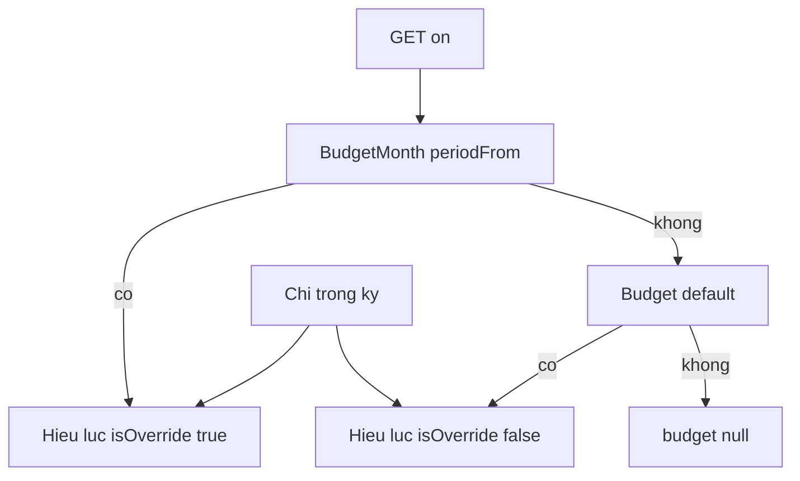

# Ngân sách tháng — BE-P2-E02 / MOB-P2-E02

Contract: [OpenAPI](../../packages/api-contracts/openapi.yaml) `/api/v1/budgets/current`. Module: [07-budgets](../product/modules/07-budgets.md).

## Mô hình

- **Mặc định** (`Budget`): một hàng / user. Áp cho mọi tháng tài chính **chưa** có override.
- **Theo tháng** (`BudgetMonth`): unique `(userId, periodFrom)` với `periodFrom`/`periodTo` = biên kỳ tháng (`resolvePeriod` month). Chỉ áp đúng tháng đó.
- `BudgetCategory` / `BudgetMonthCategory`: hạn mức theo danh mục (`expense` hoặc `both`, chưa lưu trữ). `PUT` thay cả tập.
- Tiền tệ = `User.defaultCurrencyCode` lúc lưu; đổi tiền tệ hồ sơ không quy đổi hạn mức.

## Đã chi

Tổng trị tuyệt đối các giao dịch `type=expense`, `deletedAt` null, cùng tiền tệ ngân sách, `occurredOn` trong kỳ tháng của `on` (mặc định hôm nay theo timezone). Thu và chuyển khoản không tính. Chi khác tiền tệ bỏ qua.

Dòng danh mục: chi đúng `categoryId` cộng chi của mọi danh mục con. Chi chưa phân loại chỉ vào tổng.

## Mức và ngưỡng

So sánh bằng nhân chéo (`spent * 100` với `limit * 70` / `90`):

| Điều kiện | status |
|---|---|
| `< 70%` | `healthy` |
| `70–90%` | `warning` |
| `> 90%` và `≤ 100%` | `critical` |
| `> 100%` | `over` |

`percentBps` = `spent * 10000 / limit` (7000 = 70,00%). Ngưỡng cảnh báo mặc định `70, 80, 90, 100`; user sửa 1–4 số 1–100 tăng nghiêm. API trả `crossedThresholds`. Push thuộc `BE-P2-E05`.

## API

Bearer session, `Cache-Control: no-store`, tiền là string integer.

- `GET /api/v1/budgets/current?on=&applyTo=` — bỏ `applyTo` (hoặc `month`): hiệu lực tháng của `on` (override nếu có). `applyTo=default`: chỉ template mặc định (để sửa «Mọi tháng»). `budget.applyTo` / `isOverride` cho biết nguồn.
- `PUT /api/v1/budgets/current` — `applyTo=default` (mặc định) cập nhật template; `applyTo=month` + `on` upsert override tháng đó. `version` theo đúng hàng đang sửa.
- `DELETE /api/v1/budgets/current?applyTo=&on=&version=` — `default` xóa template; `month` + `on` bỏ override (tháng lại dùng mặc định nếu còn).

Có trong `GET /account/export` (`budget`, `budgetMonths`) và xóa theo user. Không log hạn mức / đã chi.

## Mobile

Feature `lib/features/budgets/`. Màn `/budgets` (tuỳ chọn `?on=`) từ Cài đặt và Báo cáo (kỳ Tháng). Chọn **Mọi tháng** / **Tháng này**. Tổng quan dùng hiệu lực tháng hiện tại. Draft onboarding `PUT` template mặc định.
